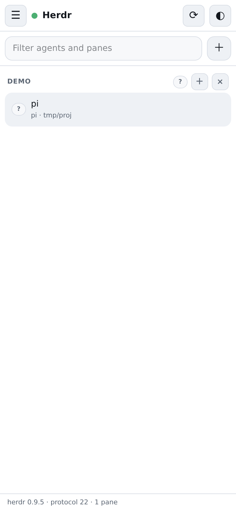
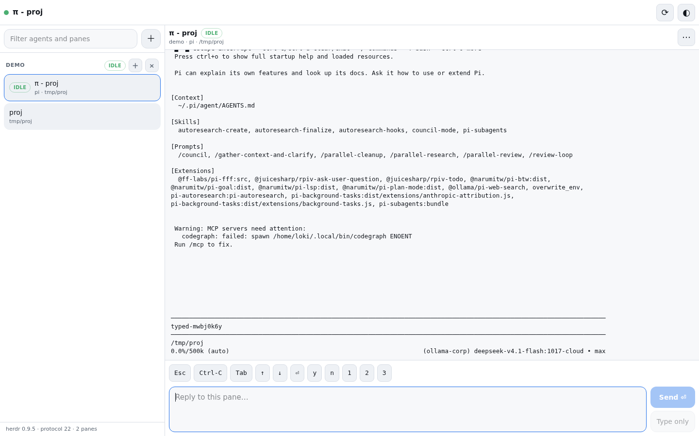
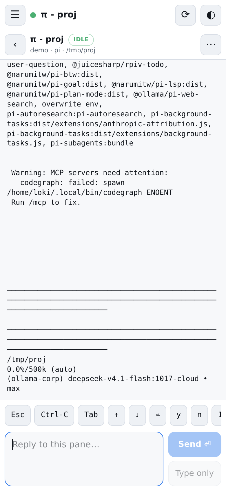
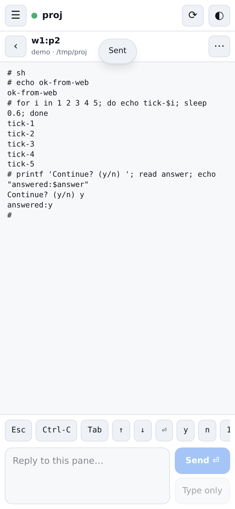

# Herdr Web

A [Herdr](https://herdr.dev) plugin that puts your session in a browser: on your
phone and on your desktop, no SSH, no app store.

It reads every pane herdr is running, shows which agent needs you, and lets you
reply from wherever you are — with a text box, a key strip for approval dialogs,
and buttons for the structural work (new workspace, new tab, split, close).

```
  phone / laptop browser
        │  HTTP + SSE, one pairing token
        ▼
  herdr-mobile.web  (a herdr plugin, running in a herdr pane)
        │  herdr's unix socket  ($HERDR_SOCKET_PATH)
        ▼
  herdr server ── workspaces · tabs · panes · agents
```

## Screens

Captured by `container/run-e2e.sh` from a real herdr session running `pi`.

| Phone | Desktop |
| --- | --- |
|  |  |
|  | |
|  | |

## Quick start

```bash
# from a checkout
herdr plugin link "$PWD"                 # register the plugin
npm --prefix web install                 # build the web client once
npm --prefix web run build

herdr plugin action invoke herdr-mobile.web.serve     # start the server in a tab
herdr plugin action invoke herdr-mobile.web.pair      # show the link + QR
```

Open the printed link. It carries the pairing token once; the server exchanges
it for an `HttpOnly` cookie, so later visits need nothing.

From GitHub, `herdr plugin install <owner>/<repo>` runs the two build steps for
you before registering the plugin.

### Reaching it from a phone

The server binds `127.0.0.1` by default. Pick one:

```bash
node src/main.mjs --host 0.0.0.0                  # trusted LAN, plain HTTP
tailscale serve --bg 7777                         # tailnet-only HTTPS (recommended)
```

For a nicer printed link behind a proxy or Tailscale:

```bash
node src/main.mjs --host 127.0.0.1 --public-url https://herd.example.ts.net
```

`--public-url` also makes the session cookie `Secure`.

### Keep it running after a herdr restart

The server lives in a herdr pane, so it dies with the herdr server (or when you
close the tab). That is the honest default: logs stay visible and nothing is
left behind. If you want it up 24/7, run the same command under your supervisor:

```ini
# ~/.config/systemd/user/herdr-web.service
[Unit]
Description=Herdr web client
After=default.target

[Service]
ExecStart=/usr/bin/node /path/to/herdr-mobile/src/main.mjs --port 7777 --host 127.0.0.1
Restart=on-failure
Environment=HERDR_SOCKET_PATH=%h/.config/herdr/herdr.sock

[Install]
WantedBy=default.target
```

```bash
systemctl --user enable --now herdr-web
```

## What the web client does

- **Agents first.** The list is ordered by what needs you: `blocked`, then
  `working`, then `done`, then `idle`, grouped by workspace and tab.
- **Live-ish pane text.** The open pane refreshes while the tab is visible.
  Scrollback is fetched only when you ask for it.
- **Reply.** `Send ⏎` submits text and Enter in one herdr request; `Type only`
  drafts without submitting; the key strip covers `Esc`, `Ctrl-C`, `Tab`,
  arrows, `Enter`, `y`/`n`, `1`/`2`/`3` for approval dialogs and menus. Writes
  to one pane are serialized, so tapping `y` then `⏎` cannot arrive out of order
  ([ADR 0006](docs/adr/0006-serialize-writes-per-pane.md)).
- **Structure.** New workspace, new tab, split (optionally running a command
  such as `pi`), rename, close, and “show in terminal”.
- **Installable.** Manifest + service worker, so it can live on a home screen.

## Security

- One token, generated on first start as `<state>/token` (mode `0600`), compared
  in constant time. Accepted as `Authorization: Bearer`, `?token=` (the pairing
  link) or the session cookie.
- Cookie is `HttpOnly; SameSite=Strict`, plus `Secure` when the public URL is
  HTTPS.
- Writes must be `Content-Type: application/json`, which a cross-site form
  cannot send; `SameSite=Strict` covers the rest.
- The browser never touches the herdr socket. The server exposes an allowlist
  of methods and validates every parameter; `server.stop`, `plugin.*` and
  friends are unreachable from the page.
- The plugin does **not** encrypt at the application layer. Use Tailscale or a
  TLS reverse proxy if the traffic leaves the machine.

## Develop

```bash
npm test                                  # node:test, no herdr needed (fake socket)
npm --prefix web install
npm --prefix web run dev                  # UI on :5173, proxying /api to :7777
node src/main.mjs --port 7777             # the real server next to herdr
```

Everything is verified in a container against a real herdr and a real pi pane:

```bash
docker build -f container/Dockerfile -t herdr-mobile-test .
docker run --rm -v "$PWD:/work" -v "$HOME/.pi/agent:/pi-src:ro" \
  herdr-mobile-test bash container/run-e2e.sh   # 12 browser + API checks, screenshots in container/artifacts
```

## Layout

```
herdr-plugin.toml        plugin manifest: build steps, actions, panes
src/main.mjs             CLI: config, serve, print the pairing link
src/app.mjs              wires client + API + server + event bridge
src/herdr.mjs            herdr socket client (one request per connection)
src/bridge.mjs           herdr events → browser pokes
src/api.mjs              the HTTP API and its allowlist (the security boundary)
src/server.mjs           token gate, static files, SSE
src/auth.mjs             token and cookie handling
src/config.mjs           socket/state/port resolution, token file
web/                     React + Tailwind client (Vite)
container/               test image, protocol probes, end-to-end run
docs/adr/                why it is built this way
```

## Limits

- Not a terminal emulator: herdr exposes rendered pane text, not a PTY byte
  stream, so there is no cursor, mouse or ANSI colour.
- Pane text is polled, not pushed: herdr has no “output changed” subscription
  and its `revision` is a stub (see [ADR 0002](docs/adr/0002-poke-on-events-poll-the-visible-screen.md)).
- No push notifications, no multi-machine view, no conversation history yet.
  These are listed as fog on the [wayfinder map](https://github.com/the-loki/herdr-mobile/issues/1).
